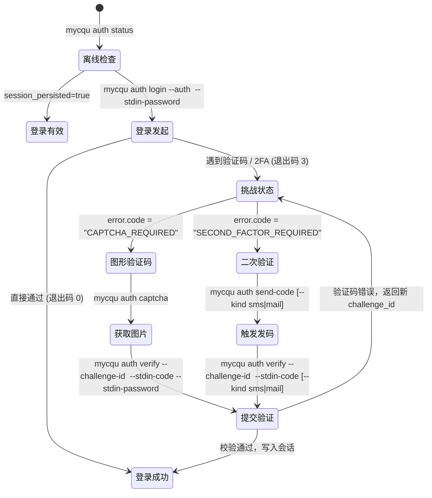

# 认证生命周期与挑战状态机 (Auth Lifecycle & Challenge State Machine)

## 1. 认证安全原则

1. **密码绝不持久化**：用户明文密码仅在内存中用于执行 SSO 认证交换，不写入磁盘配置、日志或返回结果中。
2. **会话加密保存**：登录成功后的 Cookie Jar 与服务授权上下文通过平台原生机制（Windows DPAPI 或权限受控文件）保存在用户应用数据目录中（`~/.mycqu/session.json`）。
3. **非交互式优先**：当 CLI 在无终端或 Agent 托管环境下调用时，遇挑战直接返回结构化挑战元数据，而非阻塞或挂起进程。

## 2. 状态机流转流程



## 3. Challenge 响应格式说明

当命令需要续接时，退出码为 `3`，标准 JSON 返回示例：

```json
{
  "schema_version": 1,
  "ok": false,
  "data": {
    "stage": "second_factor",
    "sms_available": true,
    "mail_available": false,
    "masked_phone": "138****1234",
    "masked_email": null
  },
  "error": {
    "code": "SECOND_FACTOR_REQUIRED",
    "message": "Second factor verification required. Call 'auth send-code' or submit code with 'auth verify --challenge-id <id> --stdin-code'.",
    "retryable": false,
    "challenge_id": "cqu-c1f7a0b39e424f2ab601837492cfa192",
    "next_action": "auth send-code"
  },
  "meta": {
    "complete": false,
    "timezone": "Asia/Shanghai"
  }
}
```

Agent 读取到此格式后，从 `error.challenge_id` 提取挑战 ID，询问用户后通过 `auth send-code` 与 `auth verify --challenge-id <ID> --stdin-code` 完成闭环。
